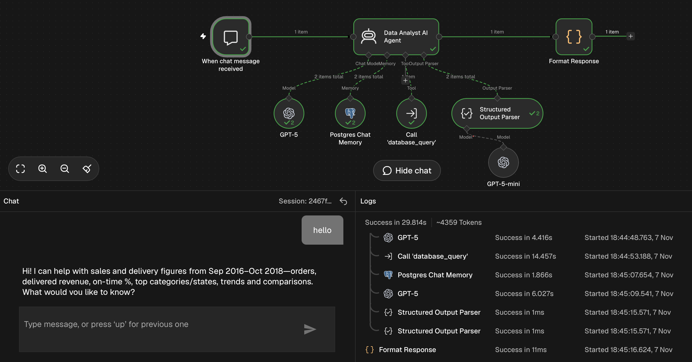

# AI Agent to Chat with E-commerce Sales & Delivery Data using Text-to-SQL, Supabase & OpenAI

**Ask questions about sales and delivery in plain English and get an answer with a chart. The model writes the SQL, and a validation layer decides whether it may run.**



## Overview

Operations and sales teams ask the same questions repeatedly: what was revenue last month, which categories lead, which states have the slowest delivery. Each one normally goes to an analyst. This chatbot lets staff ask directly, against live database tables, and shows the SQL that produced every answer.

**Stack:** n8n · Supabase (PostgreSQL) · OpenAI · Google Sheets · QuickChart

## The problem

Self-service analytics usually fails in one of two ways. Dashboards can't answer a question nobody planned for, and a chatbot that writes SQL freely can return wrong numbers or run something it should not. The goal here was a middle path: flexible questions, with controls around what the model can do.

## What it does

Example questions it handles:

- *What was total revenue last month?*
- *Which 10 product categories had the highest revenue?*
- *What share of orders were delivered late, by state?*
- *What is the average delivery time per state?*

For each question it returns a short written answer, a bar, line or pie chart when the data suits one, and writes a log row (question, generated SQL, status). Questions it cannot answer from the data, such as returns, reviews or profit, get a clear "not supported" reply and not a guess.

## How it works

```
Chat message
   → AI Agent (decides to call the database tool)
        → Sub-workflow: SQL generator → Validation → Execute → Format result → Log
   → AI Agent writes the answer + chart spec → Format Response → chat reply with chart
```

### Main workflow

| Node | What it does |
|---|---|
| Chat Trigger | Receives the user's message in the n8n chat |
| AI Agent | Understands the question, calls the database tool once, writes the final answer |
| Database tool (Call n8n Workflow) | Passes a complete, self-contained question to the sub-workflow |
| Memory | Keeps the conversation history in Supabase so follow-up questions work |
| Structured Output Parser | Forces the reply into a fixed JSON shape: answer text plus optional chart spec |
| Format Response (Code) | Validates the chart spec and builds the chart image link |

### Sub-workflow: the database tool

| Node | What it does |
|---|---|
| When Executed by Another Workflow | Receives the question |
| SQL Generator (LLM chain) | Turns the question into one SQL query, using the schema, metric definitions and worked examples in its prompt |
| Query Validation (Code) | Accepts a single read-only query on approved tables only, rejects everything else, and adds a row limit |
| Valid? (IF) | Sends valid queries on and blocked or unsupported ones straight to the reply |
| Execute Query (Postgres) | Runs the approved query |
| Format Result (Code) | Packages the rows as `ok`, `no_rows`, `unsupported` or `blocked` for the agent |
| Log (Google Sheets) | Records the question, SQL and outcome |

## Key decisions

**The model never touches the database directly.** It only produces text. A separate code step checks that the text is a single `SELECT` or `WITH` query, contains no write or admin keywords, uses only the five approved tables, and carries a row limit. Anything else is blocked before it reaches Postgres.

**Metric definitions live in the prompt.** Revenue means delivered orders only, "late" means delivered after the estimated date, and "last month" is relative to the latest order in the data. The same question therefore gives the same answer every time.

**Unsupported means unsupported.** If the data cannot answer a question, the model returns an explicit marker and the agent says so. This is safer than a plausible but invented number.

**Charts are built by code.** The agent only proposes a chart type, labels and values. The script validates them and builds the image, so a malformed chart never breaks the reply.

**One call per question.** The tool returns a status the agent can act on, which stops repeated retries and keeps API usage low.

## Data and limitations

Dataset: [Brazilian E-Commerce Public Dataset by Olist](https://www.kaggle.com/datasets/olistbr/brazilian-ecommerce). Five tables are used: orders, order items, customers, products and the category translation. The data is historical (2016 to 2018), so "last month" means the last month in the data. Returns, reviews and profit are not in these tables. The validation layer is the main control; a production version would also run queries through a read-only database role.

## Skills demonstrated

Text-to-SQL · LLM agents and tool use · Prompt design with schema and examples · Input validation and guardrails · PostgreSQL · n8n sub-workflows · Structured output parsing · Query logging

## Repository contents

- [`prompts/`](prompts/): agent and SQL generator system prompts
- [`scripts/`](scripts/): validation, result formatting and chart-building code
- [`workflow/`](workflow/): the n8n workflow exports (main and sub-workflow)
- [`docs/`](docs/): screenshots

[Back to the portfolio](../README.md)
