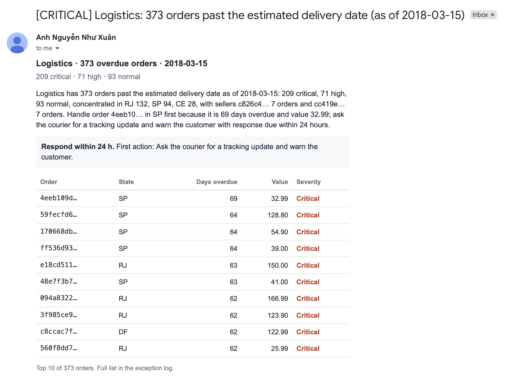
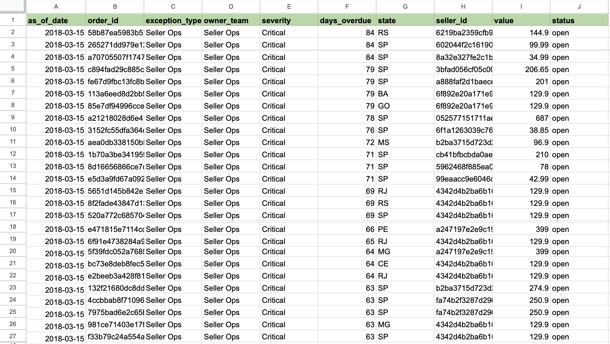
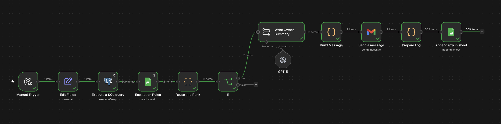

# Automate Overdue Order Detection & Team Escalation with PostgreSQL, Google Sheets & AI Alerts

**Every day it finds overdue orders, decides who owns the fix, and sends each team a short prioritised list. Every flagged order is logged for follow-up.**

## 📋 Overview

Late deliveries rarely come from one cause. Sometimes the seller has not handed the parcel to the courier, and sometimes the courier is slow. Each needs a different team to act, and the team has to know quickly which orders to chase first. This workflow turns the order data into that daily list.

**Stack:** n8n · PostgreSQL · Google Sheets · OpenAI · Gmail

## ⚠️ The problem

In many operations teams this is manual. Someone exports orders each morning, filters for late ones, works out the cause, and chases people on chat or email. It takes time, depends on who is on shift, and leaves no record of what was flagged or fixed.

## 📦 What it delivers

- **One email per owner team,** with a two-sentence summary, the response deadline and first action from the escalation table, and a ranked table of the worst orders
- **An exception log** in Google Sheets: every flagged order with date, type, owner, severity, days overdue, state, seller and value

## 🚨 How exceptions are defined

| Exception | Rule |
|---|---|
| Seller handover overdue | Order approved, not yet handed to the courier, and the seller's handover deadline has passed |
| Delivery overdue | Order is with the courier, not delivered, and the estimated delivery date has passed |

Severity comes from days overdue (Normal, High, Critical). The cut-offs, the owner team, the response deadline and the first action all sit in an **escalation table** (a Google Sheet), so the business can change the rules without touching the workflow.

| Exception type | Owner | Response | First action |
|---|---|---|---|
| Seller handover overdue | Seller Ops | 24 h | Contact the seller and confirm the ship date |
| Delivery overdue | Logistics | 24 h | Ask the courier for a tracking update and warn the customer |

## 🧩 Workflow

| Node | What it does |
|---|---|
| Manual / Schedule Trigger | Starts the daily check |
| Edit Fields (`as_of_date`) | Sets "today". Blank means the latest date in the data |
| Execute a SQL query | Finds overdue orders as of that date, using only events that had happened by then |
| Escalation Rules (Google Sheets) | Reads the owner, deadline and severity rules |
| Route & Rank (Code) | Matches each order to its rule, sets severity, groups by owner and ranks the orders |
| If | Stops quietly when nothing is overdue |
| Basic LLM Chain | Writes a two-sentence summary per owner from the pre-calculated facts |
| Build Message (Code) | Builds the email: summary, deadline, first action and top orders |
| Gmail | Sends one email per owner team |
| Prepare Log + Google Sheets | Writes every flagged order to the exception log |

## 🔑 Key decisions

**Detection is rules, not AI.** The overdue test is plain SQL. The model only writes the summary sentences, from facts the code has already calculated, so it cannot misstate a count or an order.

**The data is replayed as if it were live.** The dataset ends in 2018, so the workflow takes an as-of date and ignores anything that happened after it. An order can appear overdue on one date and drop off once it is delivered later. I tested this on a small set of constructed orders.

**Rules sit outside the workflow.** The escalation table is the operating procedure in a form a team can edit. The same table can later feed a knowledge base for an assistant.

**Alerts are scoped to be read.** Each team sees only its own orders, capped at the top 10, with the full list in the log. Cancelled orders and orders older than 90 days are excluded so old, unresolvable cases do not bury new ones.

**A log makes follow-up possible.** Every run records what was flagged and who owned it.

## 🗂️ Data and limitations

Dataset: [Brazilian E-Commerce Public Dataset by Olist](https://www.kaggle.com/datasets/olistbr/brazilian-ecommerce). Courier names and staff are not in the data, so owners are teams from the escalation table, and the email addresses are placeholders. The severity cut-offs (3 and 7 days) are starting values to be tuned from real performance. The data is historical, so the workflow uses an as-of date in place of the current date.

## 🛠️ Skills demonstrated

Operational KPI design · SQL (CTEs, point-in-time logic) · SLA and escalation design · Routing and prioritisation logic · n8n automation · Controlled use of LLMs · Audit logging

## 📁 Repository contents

- [`sql/`](sql/): the daily exception query and the monthly bottleneck analysis
- [`scripts/`](scripts/): routing, message-building and log-preparation code
- [`prompts/`](prompts/): the summary prompt
- [`docs/`](docs/): screenshots

[Back to the portfolio](../README.md)
